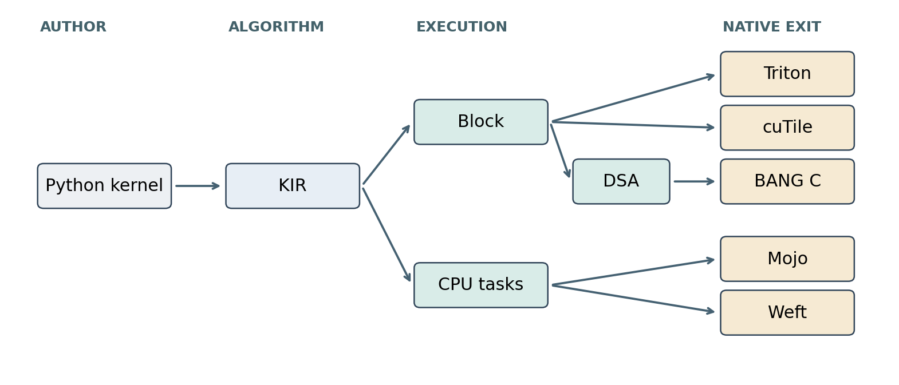

# IntentDSL

Write a tensor kernel in Python, choose a backend, and check the compiled result against a reference. IntentDSL 2.0.0 captures the types, accesses, reductions and loop state of `@I.kernel` functions. A static `@I.program` composes kernels and workspaces.

[IntentDSL 工具书 · 中文](doc/index.md) · [Handbook · English](doc/index.en.md) · [Architecture](doc/architecture.md) · [V1 paper figures](doc/paper-results.md)



## Build from source

Start in an empty directory on Linux with Python ≥3.10, Git, CMake ≥3.22, Ninja, a C++17 compiler, and LLVM **and MLIR** 20.1.8 development packages, including TableGen tools and position-independent static archives. These commands install the CompilerInfra 0.6.0 SDK and matching Python packages into local directories. The Intent wheel built by pip bundles its compiler library.

```sh
git clone https://github.com/Tianchen-ai/compilerinfra.git
git clone https://github.com/Tianchen-ai/Intent.git
git clone https://github.com/Tianchen-ai/Intent-Bench.git
python3 -m venv .venv
. .venv/bin/activate
LLVM_PREFIX=$(llvm-config-20 --prefix)
cmake -S compilerinfra -B build/sdk -G Ninja \
  -DMLIR_DIR="$LLVM_PREFIX/lib/cmake/mlir" -DCMAKE_BUILD_TYPE=Release \
  -DCOMPILERINFRA_LINK_MLIR_DYLIB=OFF -DCMAKE_INSTALL_PREFIX="$PWD/sdk"
cmake --build build/sdk --parallel 8
cmake --install build/sdk
export CMAKE_PREFIX_PATH="$PWD/sdk:$LLVM_PREFIX"
python -m pip install ./compilerinfra/python ./compilerinfra/agent
python -m pip install ./Intent
python -m pip install -e ./Intent-Bench
```

## Run your first kernel

For the following example, use an NVIDIA GPU and a driver compatible with your CUDA-enabled PyTorch installation. From the same directory:

```sh
python -m pip install torch triton
intentdsl setup --backend triton
intentdsl doctor --backend triton
python Intent/examples/first_kernel.py
```

The file below is the complete program. Save it as a Python file so the frontend can read its source. The row maximum stabilizes the exponential, and the sum normalizes each row.

```python
import torch
import intentdsl as I


@I.kernel
def softmax(x: I.In[I.f16, ("M", "N")], out: I.Out[I.f16, ("M", "N")]):
    for row in I.parallel(x.dim(0)):
        v = I.cast(x[row, :], I.f32)
        peak = I.reduce(v, axis=0, combine=I.max_num, init=I.neg_inf(I.f32))
        w = I.exp(v - peak)
        out[row, :] = I.cast(w / I.sum(w, axis=0, acc=I.f32), I.f16)


if __name__ == "__main__":
    x = torch.randn(64, 1024, dtype=torch.float16, device="cuda")
    y = I.jit(softmax, backend="triton").run(x)
    torch.testing.assert_close(y, torch.softmax(x.float(), dim=-1).half())
    print("softmax passed")
```

`setup` checks packaged assets and frontend bindings. `doctor` reports toolchain and device probes for the selected backend. A successful run prints `softmax passed` after the numerical comparison.

| Backend | Target | External requirements |
|---|---|---|
| triton | NVIDIA GPU | CUDA-enabled Torch, Triton, CUDA driver |
| cutile | NVIDIA GPU | CUDA-enabled Torch, cuda-tile, nvcc, compatible driver and GPU |
| mojo | x86-64 CPU | Mojo, GCC and libgomp; oneDNN for library contractions |
| weft | x86-64 or RVV CPU | triton-weft, weft_core and C/C++ toolchain; use a separate environment from GPU Triton |
| bangc | Cambricon MLU370 | torch_mlu, CNCC and CNRT; CNNL for library implementations |

## Measure the complete call

Run from the Bench checkout in the activated environment. The first command checks the numerical result. The second also measures hot calls against native Triton.

```sh
cd Intent-Bench
intent-bench run softmax --env examples/environments/gpu.json --output-root "$PWD/output" --case 64x1024-float16 --impl intent-v2:triton,triton --baseline triton --check-only
intent-bench run softmax --env examples/environments/gpu.json --output-root "$PWD/output" --case 64x1024-float16 --impl intent-v2:triton,triton --baseline triton
```

The [first route](doc/first-route.md) explains the result and output files. The [component guide](doc/manual.en.md#4-component-guide-components) covers inspection and candidate compilation. Both manuals are also available through `intentdsl manual --lang zh` and `intentdsl manual --lang en`.
