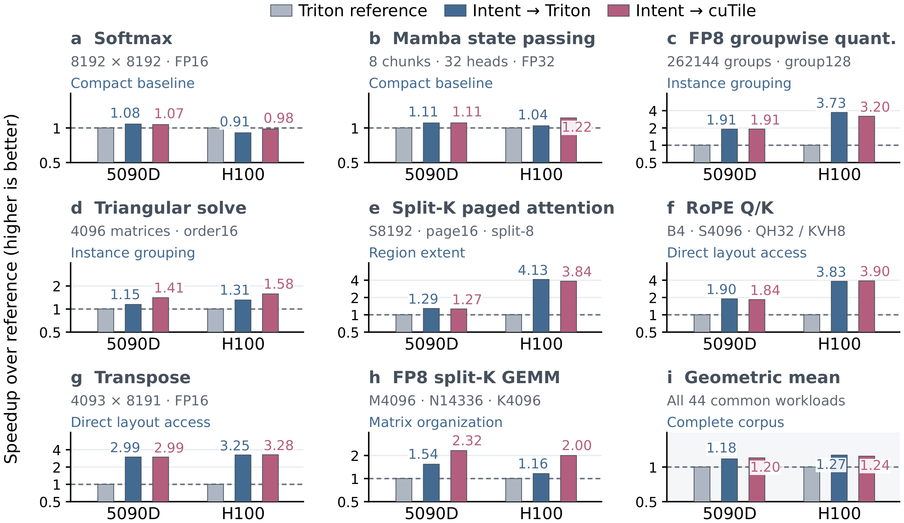
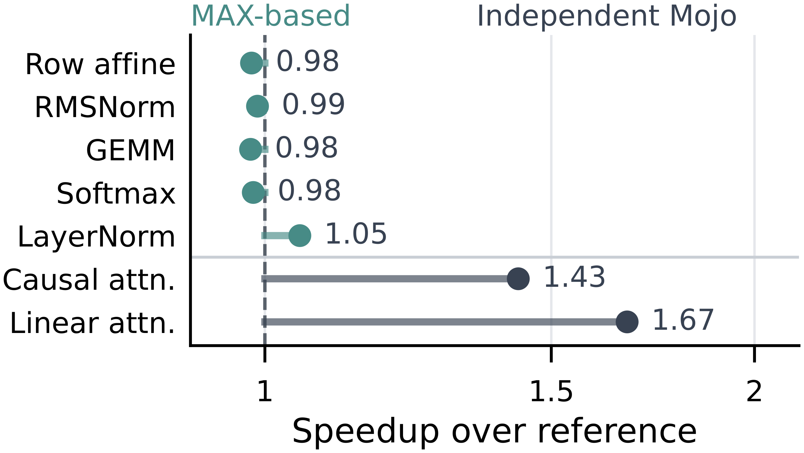
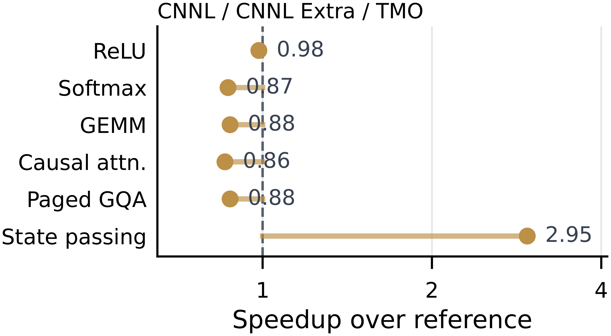

# V1 论文结果 · V1 paper evaluation

These are the original V1 paper figures. Speedup is reference latency divided by generated latency for a complete operator, including required layout conversion. Compilation and tuning are excluded. The V2 measurements use their own inputs and comparators in the [V2 scorecard](https://github.com/Tianchen-ai/Intent/blob/main/doc/plan/v2-6.md).

### GPU · Triton reference

Both generated GPU providers use the same input precision and shape. GPU measurements use CUDA Graphs or the workload’s CUDA-event protocol. [Original PDF](images/paper-eval-gpu-triton-reference.pdf)

### CPU · Native programs

Five references come from Modular/MAX and two from independent Mojo implementations. The seven bars are individual ratios. [Original PDF](images/paper-eval-cpu-native.pdf)

### MLU · Vendor libraries

CNRT notifiers time the device work. Paged GQA includes the reference’s Torch-MLU gather. [Original PDF](images/paper-eval-mlu-libraries.pdf)

The three plots and the execution-model illustration are reproduced from [V1 paper assets and provenance](https://github.com/Tianchen-ai/Intent/tree/v1/images).
